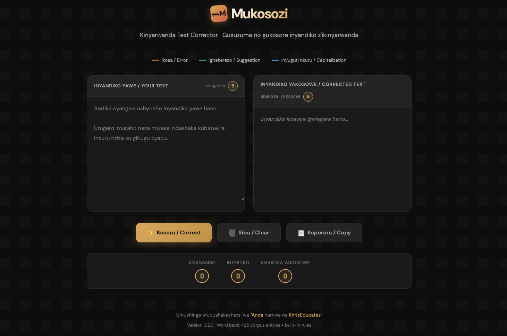
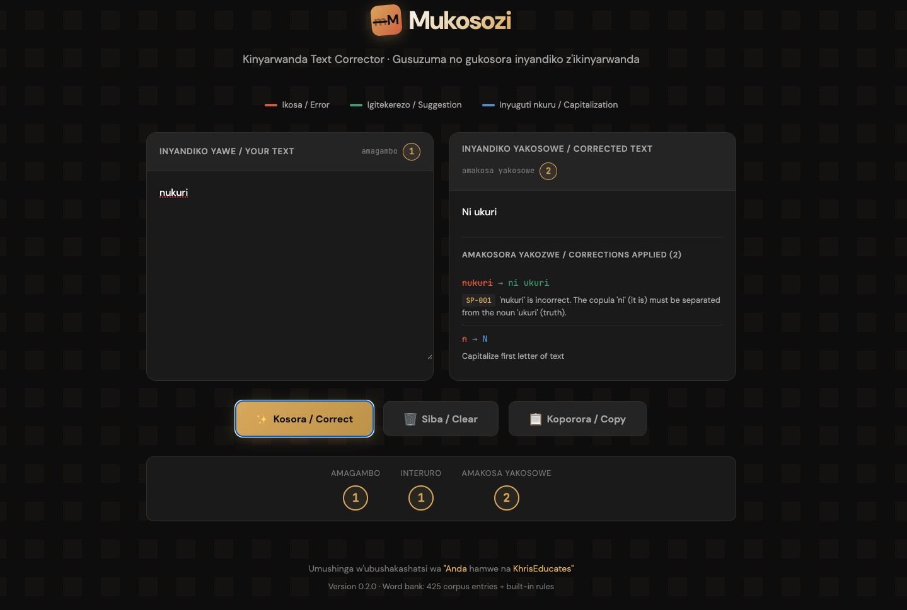
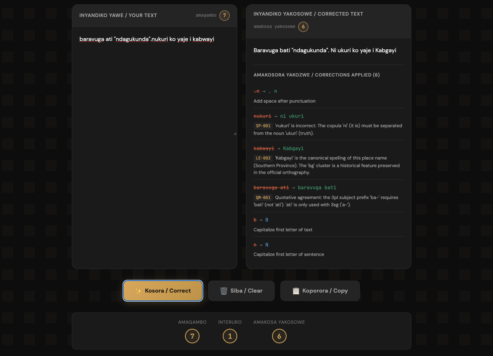
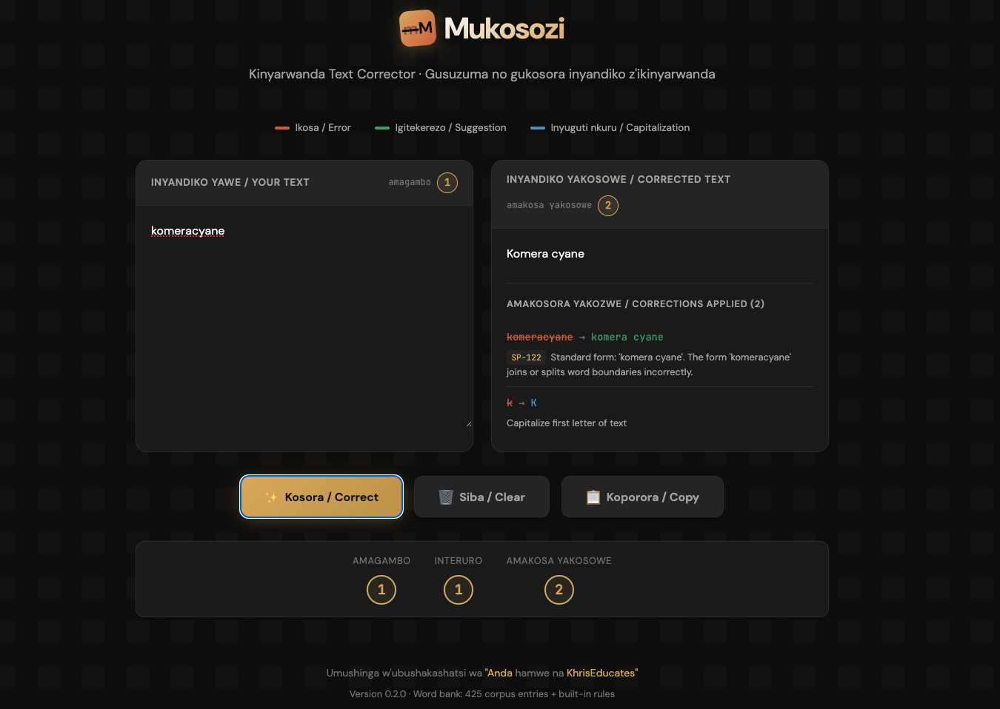

# Mukosozi

> *Open-source Kinyarwanda text correction, grounded in native-speaker rulings and an attested error corpus, for the language of ~12M speakers.*

[](https://mukosozi.rw)
[](LICENSE)
[](LICENSE-DATA)
[](#status--roadmap)

**Mukosozi** (Kinyarwanda: *the corrector, the one who corrects*) is a Kinyarwanda text correction tool, live at **[mukosozi.rw](https://mukosozi.rw)**. It targets the errors that actually occur in written Kinyarwanda: word boundaries, spelling, punctuation, capitalization, and a growing set of grammatical rules. Kinyarwanda is a Bantu language spoken by approximately 12 million people, with very limited NLP tooling available.

The project is **authored and maintained by a native Kinyarwanda speaker**. Every correction is traceable to an explicit, documented rule or to a reviewed entry in the word bank, and every word-bank entry drawn from the corpus is traceable to a dated, sourced observation of real usage. No opaque models: the tool can always say why.

---

## What it does (v0.2.0)

All rule-based, all client-side in the browser:

- **Word-boundary correction**: the single most common error class in the wild (about four in five observed errors). Fused words are split and wrongly split words are rejoined, from `komeracyane` to `Komera cyane`, from `itera mbere` back to `Iterambere`.
- **Spelling correction**: non-standard spellings restored to their standard forms, from `ibishimbo` to `Ibishyimbo`, from `byox` to `Byose`.
- **Lexical exceptions**: words with special rules (`ubukwe`, which has no plural; `Kabgayi`, which keeps its historical spelling).
- **Quotative marker agreement**: subject-prefix concord (`baravuga bati`, not `baravuga ati`).
- **Punctuation and capitalization**: spacing around punctuation, duplicate removal, sentence-initial and post-sentence capitals, proper nouns. Terminal punctuation is treated as the writer's tone and is never rewritten (see [`NORMALIZATION.md`](NORMALIZATION.md)).

The engine loads its lexicon from `data/word_bank.js` at runtime, so the tool grows with every reviewed batch pushed to this repository, with no code changes.

**The word bank today:** 433 entries. 425 are reviewed corpus entries (325 word-boundary, 100 spelling), backed by 432 attestations. Four documented grammar rules (quotative agreement, the `ejo` temporal system, copula `ni` versus imperative `ni-`, and the negation system `nta` / `si-` / `nti-`); one of them, QM-001, is executable today, the other three are documented knowledge awaiting the rule engine (v0.3). Seven entries protect standard forms that are commonly over-corrected, so the tool corrects the over-correction rather than the word.

---

## Quick start

Use it at **[mukosozi.rw](https://mukosozi.rw)**, or run it locally. Mukosozi is a static web app: one HTML file plus a data folder, no build step, no dependencies.

```bash
git clone https://github.com/mukosozi/mukosozi.git
cd mukosozi
open index.html       # macOS, or just double-click the file
```

Type or paste Kinyarwanda text on the left; corrected text appears on the right, each correction labelled with its rule or entry ID and an explanation. The footer reports how many corpus entries the engine loaded.

---

## Screenshots

### Default state



The Mukosozi interface on first load. Bilingual labels in Kinyarwanda and English, dark theme with gold accents inspired by Imigongo geometric tradition, and a legend mapping correction types to colors.

### Single correction example



A one-word input, `nukuri`, triggers rule **SP-001**: the copula `ni` ("it is") must be written separately from the noun `ukuri` ("truth"). A capitalization fix is also applied (note the blue styling matching the legend). Each correction shows its rule ID and a bilingual explanation.

### Multi-rule correction



A more complex input, `baravuga ati "ndagukunda".nukuri ko yaje i kabwayi`, demonstrates six corrections across four distinct rule families:

- **Punctuation spacing**: missing space after a period
- **SP-001**: `nukuri` split into `ni ukuri`
- **LE-002**: `kabwayi` normalized to the canonical orthography `Kabgayi`
- **QM-001**: quotative marker agreement; the 3rd-person plural subject `ba-` requires `bati` (not `ati`, which only agrees with 3rd-person singular `a-`)
- **Capitalization**: sentence-initial and post-period capitalization

### Corpus entry correction



This is what changed in v0.2.0. The fused form `komeracyane` is split into `Komera cyane` by entry **SP-122**, one of the 425 reviewed corpus entries the engine loads from `data/word_bank.js`; the explanation shown is the entry's own rule text. Its evidence lives in `data/attestations.json` under the same ID: the form was observed on WhatsApp on 1 July 2026, with the contributor's gloss ("be strong", also used as a greeting). Nothing in the code knows this word; the data does.

---

## How the word bank is built

Mukosozi's entries are not pulled from training data. They come from an attested corpus, reviewed one pair at a time by a native speaker.

1. **Collection.** In July 2026, contributor **Sarah Izabayo** collected **1,783 correction pairs** over 30 consecutive days: a mistake as written in the wild, its correction, the platform it was seen on (WhatsApp, TikTok, Instagram, X, Facebook, Snapchat, websites, AI-generated text), and an English gloss. Only the language was recorded, never who wrote it.
2. **Triage.** [`pipeline/classify_pairs.py`](pipeline/classify_pairs.py) removes duplicates (1,770 unique pairs), flags conflicts, separates cosmetic changes from the core change, and proposes a surface classification for each pair, with no claim about the language itself.
3. **Review.** The maintainer rules on every pair. Reviewed pairs become entries; the review has also produced 13 reviewer emendations (where the collected correction itself needed fixing), 7 protected forms, and three grammar rules written directly from the review.
4. **Export.** [`pipeline/export_word_bank.py`](pipeline/export_word_bank.py) writes reviewed entries into `data/word_bank.json`, the browser payload `data/word_bank.js`, and `data/attestations.json`, where every corpus entry keeps its evidence: the observed form, the corrected text exactly as attested, the gloss, the source, and the date.

The rulings the engine follows (sentence capitalization, terminal punctuation as tone, core-form headwords, intrinsic capitals such as *Imana*) are recorded in [`NORMALIZATION.md`](NORMALIZATION.md). Review of the corpus is ongoing; 425 of 1,770 unique pairs are in the bank as of this release.

---

## Project structure

```
mukosozi/
├── index.html              # The web app (HTML + CSS + JS); loads data/word_bank.js at runtime
├── CNAME                   # Custom domain for GitHub Pages (mukosozi.rw)
├── data/
│   ├── word_bank.json      # The word bank: grammar rules, lexical exceptions, neologisms
│   ├── word_bank.js        # Browser payload of the word bank (generated by the exporter)
│   └── attestations.json   # Evidence behind every corpus entry: dated, sourced observations
├── pipeline/
│   ├── classify_pairs.py   # Triage of collected pairs: dedup, conflicts, surface classification
│   └── export_word_bank.py # Reviewed rows -> word_bank.json, word_bank.js, attestations.json
├── screenshots/            # README screenshots
├── NORMALIZATION.md        # Native-speaker rulings the engine follows
├── CONTRIBUTORS.md         # Who built what
├── CONTRIBUTING.md         # How to contribute
├── LICENSE                 # AGPL-3.0, governs source code
├── LICENSE-DATA            # CC BY-NC-SA 4.0, governs linguistic data
├── NOTICE                  # Copyright and dual-licensing summary
├── favicon.* / icon-*.png  # Brand assets
└── README.md
```

---

## Status & roadmap

| Phase | Focus | Status |
|---|---|---|
| **0.1** | Rule-based corrections (punctuation, spacing, lexical exceptions, quotative markers) | ✅ Released, May 2026 |
| **0.2** | Data-driven word bank loaded at runtime; attested July 2026 corpus; attestation bank; live deployment at mukosozi.rw | ✅ Released, August 2026 |
| **0.3** | Rule engine: documented grammar rules (negation, copula vs imperative `ni-`, temporal `ejo`) become executable and apply to words never seen in the corpus | 🛠 Next |
| **0.4** | Word-boundary segmenter guided by the word bank, with protected forms as its guardrail | 📋 Planned |
| **0.5** | ML-based correction trained and evaluated on the attested corpus | 📋 Planned |
| **1.0** | Online Kinyarwanda dictionary with systematically reviewed entries and neologisms | 📋 Long-term vision |

The corpus review continues in parallel with all of the above; each reviewed batch ships to the live site as data.

---

## Linguistic foundation

Mukosozi's rules are documented explicitly by a native speaker, with the goal that every correction be explainable, auditable, and revisable.

The `data/word_bank.json` file is a structured knowledge base of:

- **Grammar rules** (quotative marker agreement, the `ejo` temporal system, copula versus imperative `ni`, the negation system)
- **Lexical exceptions** (word-boundary forms, standard spellings, uncountable nouns, unique proper-noun spellings, idiomatic phrases), each corpus entry carrying its attestations
- **Neologisms**: Kinyarwanda terms for modern concepts, with morphological analysis and rationale

This is designed to serve as the foundation for the first comprehensive online Kinyarwanda dictionary, with a rigorous review process and evidence attached to every entry.

---

## Related work

- **[LinguaMedica RW](https://linguamedica.rw)**: a curated English–Kinyarwanda medical terminology lookup, also built and maintained by the same author.

---

## License

Mukosozi uses **dual licensing** to balance openness with sustainability:

- **Source code**: [GNU Affero General Public License v3.0](LICENSE) (AGPL-3.0). You may use, modify, and distribute the code under AGPL terms, including the requirement to disclose source code of network-accessible derivatives.
- **Linguistic data** (everything under `data/` and any derived datasets in this repository): [Creative Commons Attribution–NonCommercial–ShareAlike 4.0 International](LICENSE-DATA) (CC BY-NC-SA 4.0). Free for research and non-commercial use with attribution; commercial use requires separate written permission from the maintainer.

See [`NOTICE`](NOTICE) for the full attribution and licensing summary, including the policy on neologisms and commercial licensing.

---

## Contributing

Contributions are welcome, especially from Kinyarwanda speakers and linguists. Please read [`CONTRIBUTING.md`](CONTRIBUTING.md) before opening an issue or pull request, and see [`CONTRIBUTORS.md`](CONTRIBUTORS.md) for who has built what so far.

Linguistic accuracy is critical to this project. Proposed rules and corrections are reviewed before merging, and native-speaker validation is required for linguistic changes.

---

## Citation

If you use Mukosozi in academic work, please cite:

```
Mumaragishyika, C. (2026). Mukosozi: A Kinyarwanda text correction tool (v0.2.0).
https://mukosozi.rw · https://github.com/mukosozi/mukosozi
```

---

## Maintainer

**Christophe Mumaragishyika**
Contact: `mukosozi.rw@gmail.com`

---

© 2026 Christophe Mumaragishyika. All rights reserved except where explicitly licensed under the terms above.
